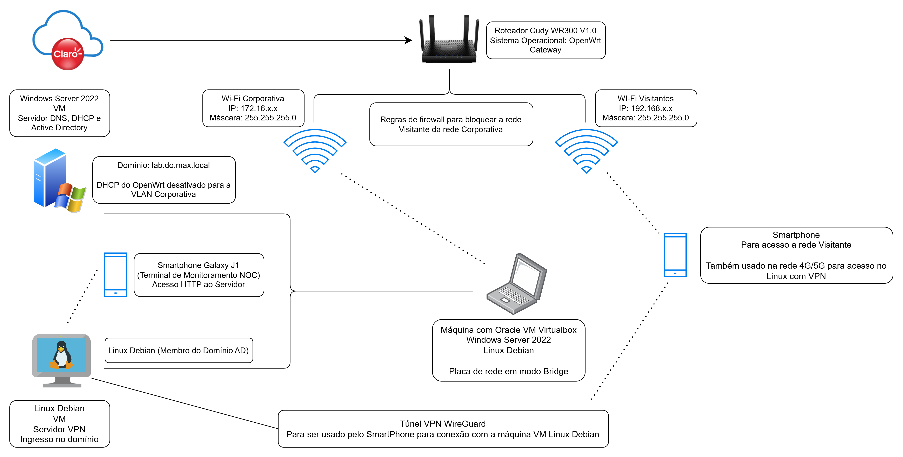

# 🛡️ Laboratório de Infraestrutura Corporativa: Borda Segura (OpenWrt), Active Directory e VPN (Em andamento)

Projeto de infraestrutura de redes focado em segmentação corporativa, isolamento de visitantes (Guest Wi-Fi), gerenciamento de identidade com Active Directory e acesso remoto seguro via VPN. Desenvolvido como parte dos estudos práticos em Redes de Computadores para consolidação de conhecimentos.

## 📌 Cenário Fictício
**Problema:** Uma filial corporativa precisa prover Wi-Fi para visitantes mantendo a rede interna protegida e isolada. Além disso, a infraestrutura exige um controle de acesso centralizado para estações de trabalho (Windows e Linux) e precisa permitir acesso seguro de funcionários em Home Office (via 4G/5G) aos recursos internos.

**Solução:** Utilização de um roteador de borda Cudy WR3000 v1.0 com firmware OpenWrt atuando como Gateway, Firewall e Servidor VPN, operando em conjunto com um servidor Windows Server 2022 (controlador de domínio) para gerenciar as credenciais e a resolução de nomes da rede corporativa.

## Planejamento & Topologia Alvo

### Visão Geral da Arquitetura
* **Borda & Segmentação:** Roteador OpenWrt isolando as redes Corporativa (172.16.x.x) e Visitante (192.168.x.x).
* **Serviços de Domínio:** Windows Server 2022 atuando Controlador de Domínio (lab.do.max.local), DNS e DHCP.
* **Acesso Remoto & Linux:** Servidor Debian 12 integrado ao AD e executando serviço de VPN WireGuard.
* **Monitoramento NOC:** Samsung Galaxy J1 atuando como dashboard dedicado de status da rede.

[Clique Aqui Para Ler os Detalhes da Documentação da Topologia](docs/Topologia/LabDoMax_Topologia_Alvo_DOCUMENTACAO.md)

## 🛠️ Tecnologias e Recursos
* **Rede e Borda:** Roteador Cudy WR3000 V1.0 (OpenWrt).
* **Virtualização:** Oracle VM VirtualBox.
* **Sistemas Operacionais:** Windows Server 2022 e Linux Debian 12.
* **Protocolos e Conceitos:**
  * VLANs (802.1Q) e múltiplos SSIDs.
  * Firewall Stateful e regras de zona (Zones & Forwarding Rules).
  * Active Directory Domain Services (AD DS), DHCP e DNS.
  * Integração de cliente Linux em domínio Microsoft (`realmd`, `sssd`).
  * VPN Criptografada (WireGuard / OpenVPN).
  * NAT e gerenciamento de Duplo NAT.

## 📂 Estrutura do Repositório
* `/docs` -> Contém a documentação técnica detalhada da arquitetura, topologia e procedimentos de rede.
* `/docs/Incidentes` -> Relatórios de *troubleshooting* e resolução de falhas ocorridas durante o projeto.

## Centralização dos Links Para o Redirecionamento das Etapas do Projeto
[Clique Aqui Para Ler Toda a Documentação Deste Projeto e Para Acompanhar as Etapas de Desenvolvimento](docs/Projeto_Borda_Segura.md)

## 🚀 Atualizações do Projeto

* **Fase 1: Infraestrutura de Borda e Segurança** (Concluída ✅)
  * Criação das interfaces corporativa (`172.16.x.x`) e visitantes (`192.168.x.x`).
  * Configuração de redes Wi-Fi e SSIDs vinculados às respectivas interfaces.
  * Implementação de políticas de Firewall para bloqueio de tráfego da rede Visitante para a rede Corporativa.
* **Fase 2: Desenho da Topologia** (Concluída ✅)
* **Fase 3: Identidade e Gestão Centralizada** (Em andamento 🔄)
  * Instalação do Windows Server 2022 no VirtualBox (Iniciada em 04/10/2026) ✅.
  * Configuração de endereçamento IP estático do Servidor na rede Corporativa (`172.16.x.x`) ✅.
  * Promoção do servidor Windows a Controlador de Domínio (AD DS), DHCP e configuração de DNS ✅.
  * Instalação de máquina virtual Linux Debian ✅.
  * Ingresso de máquina virtual Linux Debian no domínio corporativo (Pendente ⏳).
* **Fase 4: Acesso Remoto Seguro VPN** (Em andamento 🔄)
  * Configuração inicial do servidor VPN WireGuard.

---
## Registro de Incidentes

| ID | Descrição | Status |
|----|-----------|---------|
| INC-001 | **[Perda de Credenciais Administrativas](docs/Incidentes/Incidente_001/Perda_de_Credenciais_Administrativas.md)** | ✅ Concluído |
| INC-002 | **[Gargalo de Rede e Lentidão no Espelho do Debian 12](docs/Incidentes/Incidente_002/Gargalo_de_Rede_e_Lentidao_no_Espelho_do_Debian_12.md)** | ✅ Concluído |
| INC-003 | **[Bloqueio de Acesso ao Zabbix](docs/Incidentes/Incidente_003/Bloqueio_de_Acesso_ao_Zabbix.md)** | ✅ Concluído |
| INC-004 | **[Recuperação de Unidade RAW e VMs via TestDisk](docs/Incidentes/Incidente_004/Recuperacao_de_Unidade_RAW_e_VMs_via_TestDisk.md)** | ✅ Concluído |

