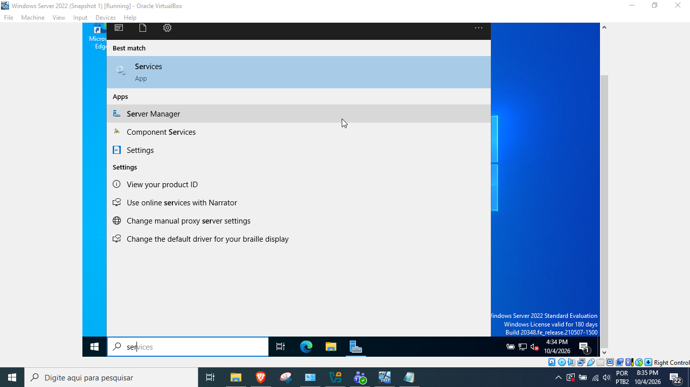
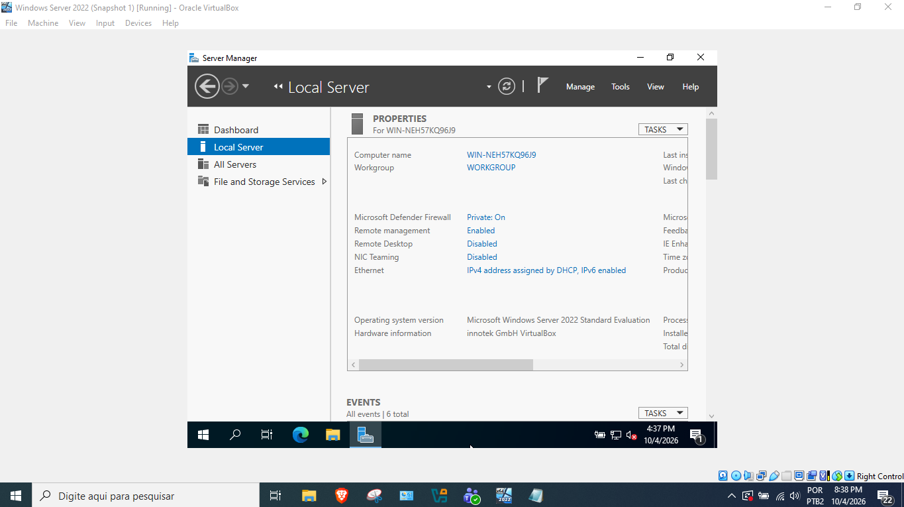
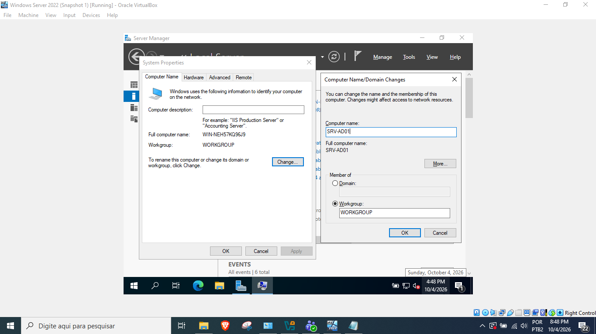
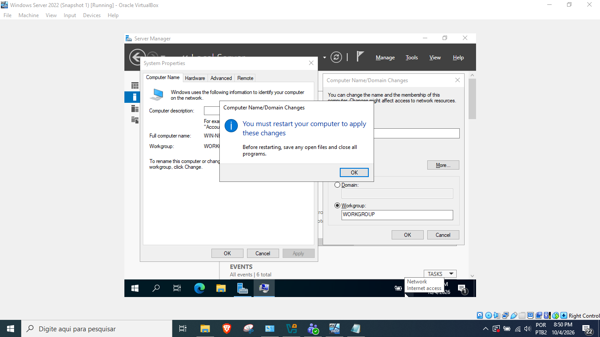
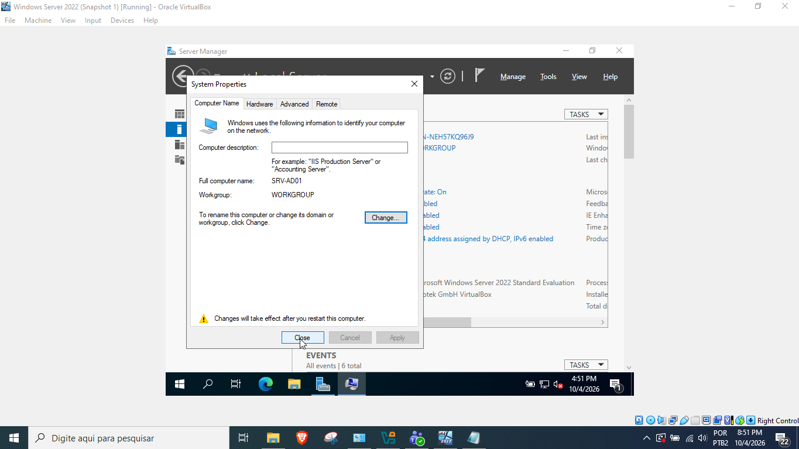
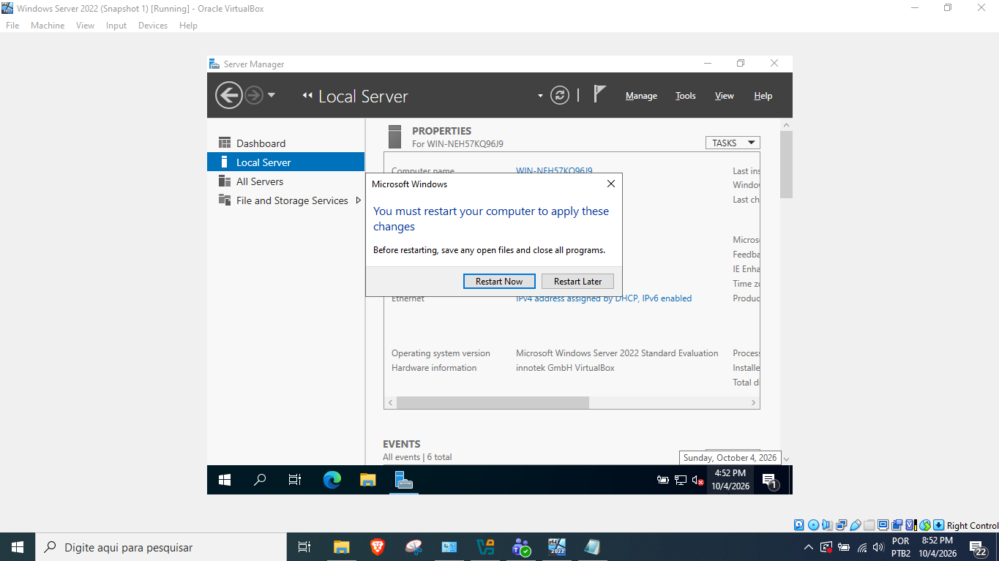
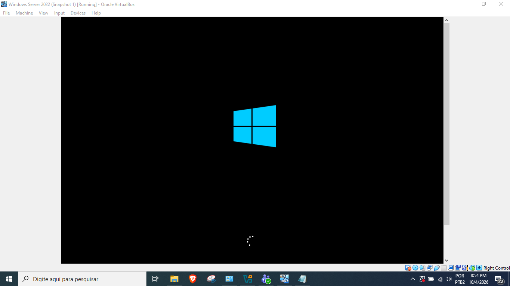
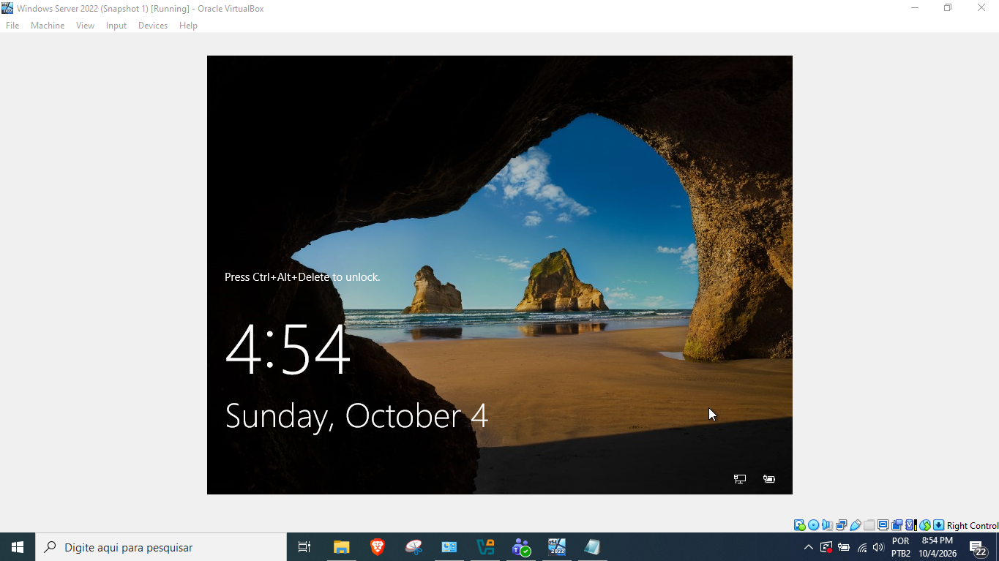
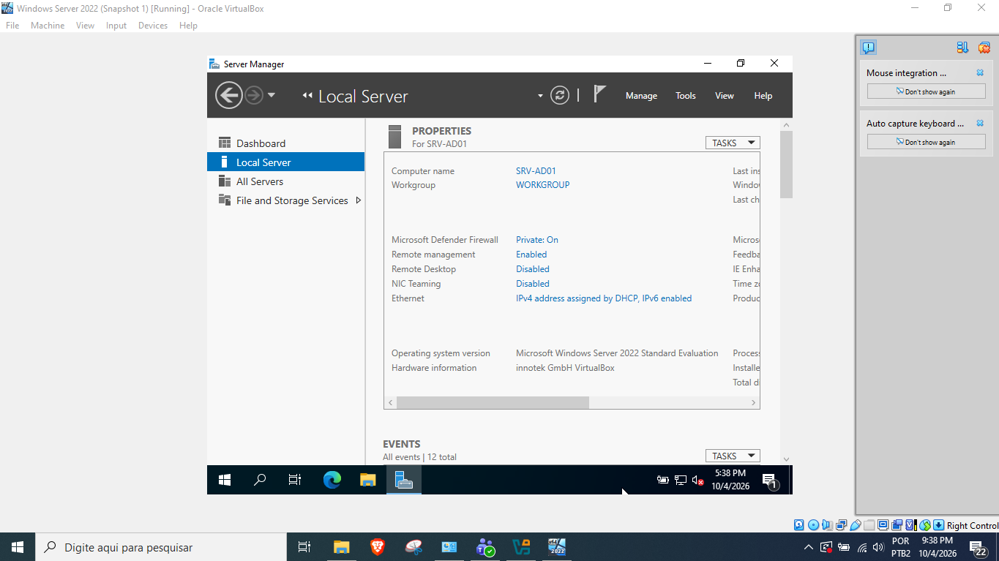

# Passo a Passo de como Nomear o Servidor

## Início

### Abra o Server Manager

### Selecione Local Server

### Clique no nome atual do servidor "WIN-NEH57KO96J9", localizado ao lado direito de "Computer Name"

### Clique em Change e depois altere o nome do servidor "Compute Name"

## 
